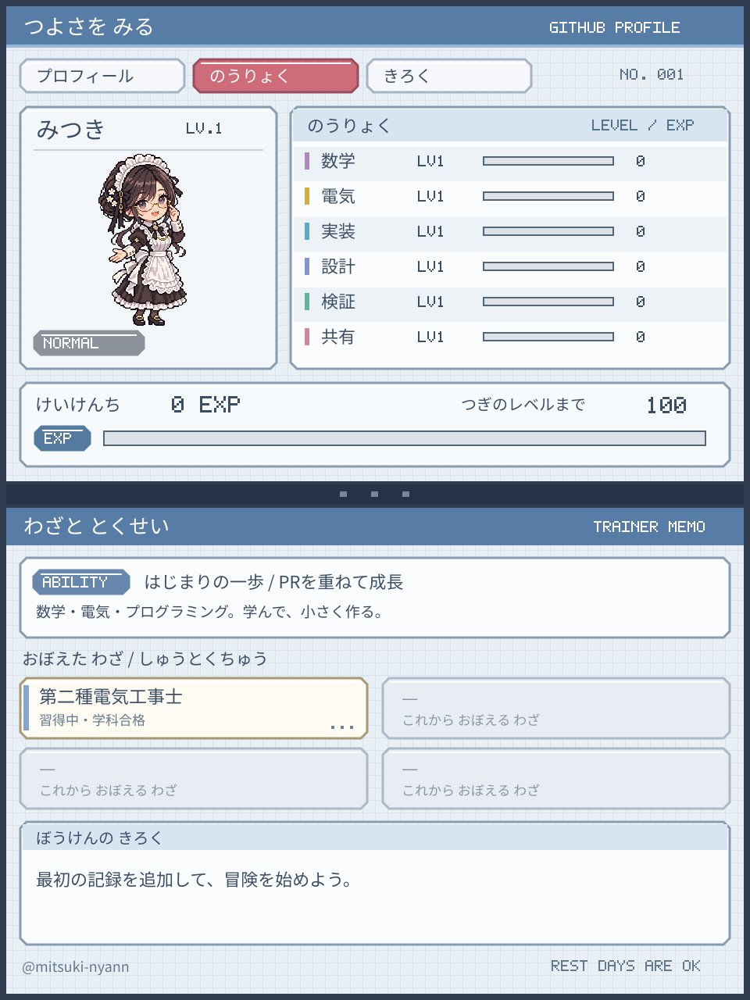

# みつき / PIXEL PROFILE

数学・電気・プログラミング。学んで、小さく作る。

- 能力値：取り組んだPRと学習記録の累積EXP
- タイプ・特性：直近20件のマージ済みPRから自動更新
- 習得中：第二種電気工事士（学科合格）

[編集・使い方](GUIDE.md) · [非公開PRの接続設定](CONNECT_PRIVATE.md) · [自動更新](https://github.com/mitsuki-nyann/mitsuki-nyann/actions)

---

## Hi there 👋

<!--
**mitsuki-nyann/mitsuki-nyann** is a ✨ _special_ ✨ repository because its `README.md` (this file) appears on your GitHub profile.

Here are some ideas to get you started:

- 🔭 I’m currently working on ...
- 🌱 I’m currently learning ...
- 👯 I’m looking to collaborate on ...
- 🤔 I’m looking for help with ...
- 💬 Ask me about ...
- 📫 How to reach me: ...
- 😄 Pronouns: ...
- ⚡ Fun fact: ...
-->
